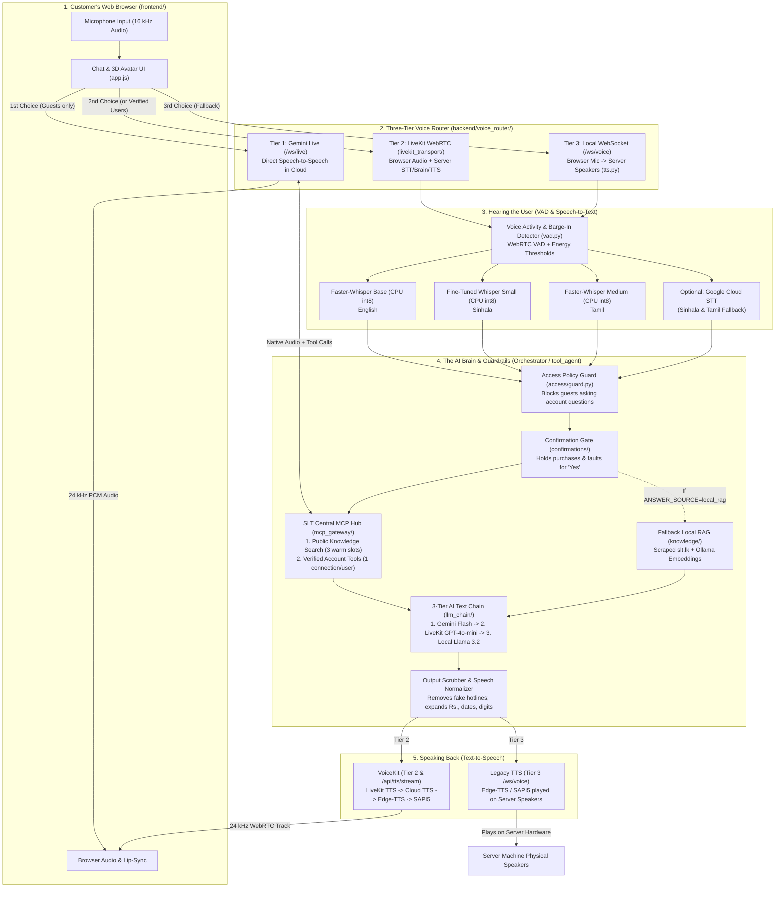

# Dilshan's Proposed Optimization Plan
**System Inspection & Architecture Report — SLT Mobitel Multilingual Voice Interaction Backend (`voice-interaction-layer-backend`)**  
**Branch Inspected:** `dilshan/further-development` (Read-Only Audit)  
**Date:** October 24, 2026

---

## 1. Executive Summary

### What the System Is
The **SLT Mobitel Voice Interaction Backend** is a multilingual (English, Sinhala, and Tamil) customer-service assistant that lets visitors either **speak out loud** to an animated 3D avatar or **type in a chat box**. It is designed to answer general questions about SLT Mobitel broadband, fibre, mobile, and PeoTV packages, and—once a customer verifies their identity with a one-time code (OTP)—look up their personal account balances, bills, data usage, and package upgrades through SLT's central **MCP Integration Hub**.

### Current Maturity Level
**Late Prototype / Pre-Pilot (Maturity Level: 2.5 / 5).**  
The project has impressive breadth: it includes a 3-tier voice fallback router, a 3-tier AI text fallback chain, a central MCP Hub gateway with per-customer session isolation, a 3-step customer verification wizard, a speech normalizer for currency and phone numbers, a hallucination scrubber, and a 3D lip-synced avatar.

However, the codebase grew through rapid, back-to-back feature sprints where new architectures were layered on top of older ones without retiring the old code. As a result, several critical paths—including **Gemini Live (Tier 1)**, **LiveKit Cloud TTS (Tier 2)**, and **live customer account tools on the SLT Hub**—have only been tested against simulated mocks rather than live services (due to unfunded API keys and upstream 405 errors on the hub).

### Overall Health Status
**🟡 Yellow / Needs Stabilization Before Deployment**

| Area | Status | Plain-English Summary |
| :--- | :--- | :--- |
| **Packaging & Startup** | 🔴 **Broken on Clean Install** | Three core files import non-existent package names (`httpx2` and `mcp_types`) from a developer's customized local machine, and `requirements.txt` has a version conflict (`openai==3.17.0` vs. `livekit-agents==1.8.4`) that breaks standard `pip install`. |
| **Voice Pipeline & Failover** | 🟡 **Partially Working** | The 3-tier failover design is smart, but Tier 1 (Gemini Live) has no funded API key, Tier 2 (LiveKit) drops the customer's phone number so verified users cannot check their accounts, and Tier 3 (Local WebSocket) plays audio out of the **server computer's physical speakers** instead of the user's browser. |
| **Authentication & Security** | 🟡 **Split / Conflicting** | Two competing OTP login systems (`/auth/otp/*` and `/verify/*`) exist side-by-side. Logging in via the older `/auth/*` routes leaves the user classified as a "Guest," and clicking Logout after using the new `/verify/*` wizard fails to clear the server session. |
| **Multilingual Accuracy (EN / SI / TA)** | 🟡 **English Good; SI/TA Slow** | English works well end-to-end. Sinhala and Tamil suffer from slow speech recognition (no live captions in Sinhala), awkward machine translations on the local Llama model, and digit-by-digit number reading. |
| **Guardrails & Privacy** | 🟢 **Strong Foundation** | Account data is strictly gated behind server-side session tokens, customer phone numbers are bound server-side (preventing prompt injection from reading another person's bill), and unverified guests are blocked from account topics before any AI model runs. |

---

## 2. Current System Map

### Visual Overview of the End-to-End Architecture

---

### Step-by-Step Plain-English Walkthrough (Voice In $\rightarrow$ AI Thinking $\rightarrow$ Voice Out)

#### Step 1: Choosing a Language and Signing In (Browser)
1. **Language Selection:** The visitor picks **English**, **සිංහල (Sinhala)**, or **தமிழ் (Tamil)** on the first screen, then chooses **Voice** or **Chat**.
2. **Guest vs. Existing Customer:**
   - **New User (Guest):** Enters immediately with no login. They can only ask general public questions about SLT packages, prices, and coverage.
   - **Existing Customer (Verified):** Opens a 3-step verification wizard (`frontend/verify/verify.js`) that asks for their name and SLT landline number, sends a 6-digit one-time code (OTP) via the SLT Hub (or local SMS/email sender), and verifies the code. Upon success, the backend sets an encrypted `user_session` cookie and holds open a dedicated connection to the SLT MCP Hub for that customer.

#### Step 2: Selecting the Voice Path (The 3-Tier Voice Router)
Before opening the microphone, the browser asks the server (`GET /api/voice/tier`) which of the **three voice pathways** is healthy right now:
- **Path 1 — Gemini Live (`gemini_live` over `/ws/live`):**
  - *How it works:* The browser streams 16 kHz microphone audio over a WebSocket to the backend, which forwards it directly to Google's `gemini-3.8-live` speech-to-speech model. Gemini listens, thinks, calls SLT Hub tools through the backend, and streams 24 kHz spoken audio directly back to the browser.
  - *Important Privacy Rule:* Because the project owner set `CUSTOMER_DATA_TO_CLOUD_LLM=false` by default (to keep personal account details off public cloud AI models), **verified customers are automatically skipped past Tier 1** to Tier 2.
- **Path 2 — LiveKit WebRTC (`livekit`):**
  - *How it works:* If Gemini Live is down (or the user is a verified customer), the browser joins a real-time WebRTC audio room via LiveKit (`frontend/livekit-voice.js`). The backend's embedded worker (`LiveKitVoiceSession`) joins the same room, listens to the user's microphone track, runs speech recognition and AI reasoning on the server, and streams a 24 kHz voice track (`agent-voice`) back to the browser.
- **Path 3 — Local WebSocket (`/ws/voice`):**
  - *How it works:* If both Gemini Live and LiveKit are unavailable, the browser falls back to the original `/ws/voice` WebSocket. The browser sends 0.25-second chunks of microphone audio to the server. **Crucial quirk:** On this path, the server does not send audio back to the browser—it plays the spoken reply out of the **server computer's own physical speakers** while sending text captions to the browser screen.

#### Step 3: Greeting & Microphone Calibration
When a voice session starts on Tier 2 or Tier 3:
1. The assistant speaks a fixed greeting in the chosen language (*"Hello Guest, welcome to SLT Mobitel..."*).
2. Immediately after the greeting finishes, the server enters a **1-second `calibrating` state**, measuring the microphone's volume to estimate background room noise (`vad.py`).
3. The status then flips to **`listening`**.

#### Step 4: Hearing the User & Converting Speech to Text (`vad.py` & `stt.py`)
1. **Voice Activity Detection (`vad.py`):** As 0.25-second audio chunks arrive, the server combines Google's WebRTC VAD (which checks if the sound resembles human vocal frequencies) with a volume threshold (2.5× the calibrated background noise floor) to detect when the customer starts and stops speaking.
2. **End-of-Turn Detection:** Once the user stops speaking for **0.5 seconds** (or **0.75 seconds** in Sinhala), the server marks the turn complete and switches to **`thinking`**.
3. **Speech-to-Text (`stt.py`):**
   - **English:** Transcribed locally on the CPU by `faster-whisper` (`base` model, `int8`). Every 1.5 seconds while the user talks, it sends a live partial caption to the screen.
   - **Sinhala:** Transcribed locally by a fine-tuned Sinhala Whisper model (`janiduchamika/faster-whisper-small-sinhala-ct2-float16`). Live partial captions are turned off because CPU decoding is too slow; the full text appears 1.5–3 seconds after the user stops speaking.
   - **Tamil:** Transcribed locally by `faster-whisper` (`medium` model, `int8`), with optional fallback to Google Cloud Speech-to-Text if configured.

#### Step 5: Security Checks, Data Retrieval & AI Thinking (`Orchestrator` & `tool_agent`)
Once the user's spoken words are turned into text, the `Orchestrator` (`backend/agent.py`) runs a strict sequence before any AI model generates a reply:
1. **Small-Talk Fast Path:** Simple greetings (*"hello"*, *"thank you"*, *"ආයුබෝවන්"*, *"வணக்கம்"*) are answered instantly from pre-written templates without calling the hub or an AI model.
2. **Guest Access Guard (`access/guard.py`):** If the caller is a Guest, a fast rule-and-keyword filter checks whether they are asking about personal account data (*"my bill"*, *"my balance"*, *"මගේ බිල"*, *"எனது கட்டணம்"*). If so, the request is blocked immediately with a polite prompt to sign in.
3. **Pending Confirmation Check (`confirmations/`):** If a verified customer was just asked *"Would you like to buy the 10 GB Extra GB add-on for Rs. 500? Please say yes or no"*, the system intercepts their *"yes"* or *"no"* and executes (or cancels) the purchase on the SLT Hub once—never retrying a financial transaction.
4. **Information Lookup (`ANSWER_SOURCE`):**
   - **Central Hub Mode (`ANSWER_SOURCE=mcp_hub`, the default):**
     - *For Verified Customers asking about their account:* `customer_service.fetch()` calls the SLT Hub over the customer's dedicated connection (e.g., `show_gb_balance`, `show_bill_history`, `show_service_detail`), forcing the customer's own verified phone number into the request.
     - *For Public SLT Questions:* `tool_agent/knowledge.py` searches the SLT Hub's `search_knowledgebase_tool` using a pool of 3 warm connections (and caches answers for 10 minutes). If the hub returns nothing, the system checks whether the question is off-topic (e.g., weather or sports) and politely declines without running the AI model.
   - **Local Storage Mode (`ANSWER_SOURCE=local_rag`, fallback):** Searches the local vector database (`data/knowledge/index.npz`, built from scraped `slt.lk` pages using Ollama `nomic-embed-text`).
5. **AI Text Generation (`llm_chain/`):**
   - The retrieved facts are handed to the **3-Tier AI Text Chain** (`LLM_CHAIN=gemini,livekit,local`):
     1. **Tier 1 — Google Gemini (`gemini-flash-latest`):** Fastest cloud model. If it fails (e.g., depleted API key or rate limit), a 5-minute circuit breaker trips and skips it on subsequent turns.
     2. **Tier 2 — LiveKit Inference (`openai/gpt-4o-mini`):** Cloud fallback accessed using the project's existing LiveKit credentials.
     3. **Tier 3 — Local Ollama (`llama3.2:3b`):** Offline model running on the server itself. **Privacy rule:** Whenever a turn contains personal customer account data (and `CUSTOMER_DATA_TO_CLOUD_LLM=false`), the system **skips Tiers 1 and 2** and runs exclusively on local Llama 3.2 so personal data never leaves the building.

#### Step 6: Cleaning, Normalizing & Speaking the Reply (`scrub.py`, `voice_text/`, `voicekit/`)
1. **Hallucination Scrubber (`tool_agent/scrub.py`):** As sentences stream out of the AI model, the scrubber deletes any sentence containing a phone number, hotline, email, or website URL that did not come from the SLT Hub or the official SLT directory (`1212`, `1222`, `0712445566`).
2. **Speech Normalization (`voice_text/normalizer.py`):** Before text is handed to a voice engine, currencies (`Rs. 4,590.50` $\rightarrow$ *"four thousand five hundred ninety rupees and fifty cents"*), dates, units (`GB` $\rightarrow$ *"gigabytes"*), and phone numbers (read digit-by-digit) are expanded so the voice engine pronounces them naturally.
3. **Speech Synthesis (`voicekit/` or `tts.py`):**
   - Each sentence is converted into audio as soon as it arrives (while the AI is still writing the next sentence).
   - **Cloud/Neural Voices:** Uses LiveKit Inference TTS (if enabled), Google/Azure Cloud TTS (if keys are configured), or **Microsoft Edge Neural TTS (`edge-tts`)**, which provides free neural voices for English (`AvaMultilingual`, `AndrewMultilingual`), Sinhala (`si-LK-ThiliniNeural`, `si-LK-SameeraNeural`), and Tamil (`ta-LK-SaranyaNeural`, `ta-LK-KumarNeural`).
   - **Offline Fallback:** If the internet is down, falls back to Windows SAPI5 (`pyttsx3`, English only).

---

## 3. Broken or Conflicting Elements

Below is the complete table of real bugs, broken features, configuration conflicts, dependency clashes, and dead files identified across the codebase.

| # | Severity | Category & Location | What Is Broken / Conflicting | Root Cause in Code | How It Should Be Fixed |
| :--- | :--- | :--- | :--- | :--- | :--- |
| **1** | 🔴 **Critical** | **Startup Crash (Missing Imports)** `backend/mcp_client/client.py` (L55, L538) `backend/mcp_gateway/session.py` (L26) `backend/mcp_client/check.py` (L41) | The backend crashes immediately on startup (`ModuleNotFoundError: No module named 'httpx2'`) on any clean machine or server. | A developer renamed `httpx` to `httpx2` and `mcp.types` to `mcp_types` inside their local machine's Python `site-packages` folder (noted in `log_safety.py` L13) and committed `import httpx2` and `import mcp_types` into the code, while `requirements.txt` installs standard `httpx`. | Replace `import httpx2` with `import httpx` across `client.py`, `session.py`, and `check.py`, and replace `import mcp_types as types` with `from mcp import types` in `client.py` L538. |
| **2** | 🔴 **Critical** | **Dependency Conflict** `requirements.txt` (L13, L80–83) `backend/stt.py` (L72) `backend/voicekit/providers/piper_si.py` (L106) | Running a standard `pip install -r requirements.txt` fails with a dependency conflict, and several direct imports are missing from `requirements.txt`. | 1. `requirements.txt` pins `openai==3.17.0`, but `livekit-agents==1.8.4` requires `openai<3` (forcing a manual `--no-deps` workaround). 2. `huggingface_hub` and `onnxruntime` are imported directly in code but omitted from `requirements.txt`. 3. `webrtcvad==2.0.10` fails to compile on Python 3.12+ without legacy `setuptools` (`pkg_resources`) and C++ build tools. 4. Several version pins (`fastapi==0.141.1`, `sqlalchemy==2.1.1`, `cryptography==50.0.1`) do not match standard PyPI releases. | Pin compatible PyPI versions (`openai>=1.50,<3.0`), explicitly add `huggingface-hub` and `onnxruntime` to `requirements.txt`, and replace `webrtcvad==2.0.10` with `webrtcvad-wheels` (or Silero VAD). |
| **3** | 🔴 **Critical** | **LiveKit Account Access Broken** `backend/livekit_transport/tokens.py` (L204–212) `backend/livekit_transport/session.py` (L517–525) | Verified customers using **Voice Tier 2 (LiveKit)** cannot access any personal account data (bills, balances, packages) or confirm actions. | `tokens.py` sets `attributes["access"] = "verified"` in the LiveKit JWT but never includes the customer's `phone_e164`. Then `LiveKitVoiceSession._access()` builds `AccessContext.verified(None, user_name, None, language)` with `phone_e164=None`. Both `customer_service.fetch()` and `mcp_gateway` check `access.phone_e164`, see `None`, and silently skip or refuse all customer tools! | In `LiveKitVoiceSession`, resolve the verified user's `user_id` and `phone_e164` from the signed participant identity (`user-<id>`) via `auth.users.get_user(id)` and pass them into `AccessContext.verified(user.id, user.display_name, user.phone_e164, ...)`. |
| **4** | 🔴 **Critical** | **Tier 3 Audio Plays on Server Speakers** `backend/server.py` (L316–370) `backend/tts.py` (L311–398) | When a user connects on Tier 3 (`/ws/voice`), the assistant's voice plays out of the **backend server machine's physical speakers** (`sounddevice` / `pyttsx3`) instead of the user's browser! | `/ws/voice` was originally built for a single-laptop demo and still calls `tts.speak_stream()`, which opens a local hardware audio output stream on the server instead of sending audio frames over the WebSocket. Remote users hear total silence. | Replace `tts.speak_stream()` in `server.py` with `voicekit.synthesize_stream()` and stream 24 kHz binary PCM audio frames over `/ws/voice` to the browser (reusing the browser playback logic already written in `frontend/live-voice.js`). |
| **5** | 🟠 **High** | **Duplicate Auth Systems & Guest Downgrade Bug** `backend/otp/routes.py` (L136) `backend/auth/routes.py` (L148) `backend/auth/access_context.py` (L4–7, L57) | Two overlapping OTP login systems exist (`/auth/otp/*` and `/verify/*`). Users who sign in via `/auth/verify` (PIN) or `/auth/otp/verify` are still treated as **unverified Guests**! | `auth/access_context.py` only grants verified access if the JWT token contains `"otp"` in its `amr` claim (`AccessContext.from_claims(amr, ...)`). Only `/verify/otp/verify` sets `extra={"amr": ["otp"]}`—both `/auth/verify` and `/auth/otp/verify` issue tokens with no `amr` claim at all! | Retire the legacy `/auth/otp/*` module, standardize on the 3-step `/verify/*` wizard, or include `extra={"amr": ["otp"]}` in `/auth/otp/verify` if kept. |
| **6** | 🟠 **High** | **Broken Logout for Verified Users** `frontend/app.js` (L486–496, L1322–1330) `backend/verification/routes.py` (L133) | Clicking the **Logout** button after signing in through the verification wizard does **not** clear the `user_session` cookie or close the open SLT Hub session on the server. | `/verify/otp/verify` sets an `httpOnly` cookie and does not return a `token` field in its JSON body, so `sessionToken` stays `null` in `app.js`. When the user clicks `#logout-button`, `app.js` checks `if (sessionToken)` (which is `null`) and skips the server logout call entirely! Even when called, it calls `/auth/logout` instead of `/verify/logout` (which is the endpoint that closes the SLT Hub session). | Update `#logout-button` in `frontend/app.js` to always call `POST /verify/logout` with `credentials: "include"`, regardless of whether `sessionToken` is set in memory. |
| **7** | 🟠 **High** | **Spoken "Yes" Confirmation Broken on Tier 1** `backend/gemini_live/session.py` `backend/confirmations/api.py` (L152–175) | On Tier 1 (`gemini_live`), if a customer says *"Yes"* out loud to confirm a package purchase or fault report, nothing happens. | In `GeminiLiveSession`, the user's spoken *"yes"* goes straight to the Gemini model instead of `confirmations.intercept()`. Furthermore, state-changing tools are stripped from Gemini's tool list for safety, so Gemini cannot run the purchase itself. Only clicking the browser popup button works. | In `GeminiLiveSession._from_gemini()`, check completed `input_transcription` turns against `confirmations.intercept(access, text, language)` when a pending action exists, and feed the confirmation result back to the user and Gemini. |
| **8** | 🟠 **High** | **Hallucination Filter Bypassed on Tier 1 Audio** `backend/gemini_live/session.py` (L289–303) `backend/tool_agent/scrub.py` | On Tier 1 (`gemini_live`), the output filter (`tool_agent.scrub`) never runs on the spoken audio or transcript, allowing Gemini to speak invented phone numbers or URLs. | Gemini Live streams native 24 kHz audio directly from Google's servers as it speaks, so text-based sentence filtering (`scrub.filter_stream`) cannot intercept the audio before it is heard. | Run `scrub.clean_text()` on `output_transcription` in `GeminiLiveSession` so any invented contact number in the caption triggers the official SLT hotline notice (`1212`), and tighten the negative system prompt in `gemini_live/instructions.py`. |
| **9** | 🟡 **Medium** | **Conflicting LLM Config Settings** `backend/config.py` (L29–63) `backend/agent.py` (L469–514) `backend/llm_chain/tiers.py` (L97–115) | Setting `CLOUD_LLM_PROVIDER`, `OPENAI_API_KEY`, or `CLOUD_REASONING_STAGE` in `.env` has **zero effect** on the assistant. | `config.LLM_CHAIN` defaults to `["gemini", "livekit", "local"]`. Because `Orchestrator._respond_stream()` checks `if config.LLM_CHAIN:` first, the older `CLOUD_LLM_PROVIDER` and `GptAgent` (`OPENAI_API_KEY`) code in `agent.py` is completely bypassed. Moreover, `llm_chain/tiers.py` has no `"gpt"` / OpenAI tier registered. | Register `"gpt"` (`GptAgent`) as a tier inside `llm_chain/tiers.py` and remove the obsolete `CLOUD_LLM_PROVIDER` and `CLOUD_REASONING_STAGE` settings from `config.py` and `.env.example`. |
| **10** | 🟡 **Medium** | **Double Speech Text Normalization** `backend/server.py` (L319–361) `backend/tts.py` (L343–355) `backend/tool_agent/voice.py` | Every sentence spoken on `/ws/voice` is normalized **twice** by two different normalizers (`tool_agent.voice.for_speech` and `voice_text.normalizer.normalize`). | `server.py` calls `_for_speech()` on streamed chunks (converting `Rs. 1,250` to `1250 rupees`), and then `tts._prepare_sentence()` runs `voice_text.normalizer.normalize()` (which runs up to 5 regex passes) on the same sentence. | Remove `tool_agent.voice.for_speech()` and rely on `voice_text.normalizer.normalize()` (`prepare_for_tts`) as the single speech normalizer across all voice paths. |
| **11** | 🟡 **Medium** | **1-Second Post-Greeting Calibration Trap** `backend/server.py` (L206–215) `backend/livekit_transport/session.py` (L310–353) `backend/vad.py` (L121–128) | If a customer starts speaking within 1 second after the greeting ends, their first words are lost **and** the microphone becomes deaf to their normal voice for the rest of the call. | The server uses the first 1.0 second of audio after the greeting to measure background room noise (`noise_floor_rms = max(rms * 2.5, 0.003)`). If the user speaks during that second, `vad.py` sets the "noise floor" to **2.5× the user's speaking volume**, causing subsequent normal speech to be rejected as noise! | Cap `noise_floor_rms` at a safe ceiling (e.g., `min(max(rms * 2.5, 0.003), 0.025)`) in `vad.py`, or replace the 1-second blocking calibration pause with a continuous percentile/minimum-statistics noise tracker. |
| **12** | 🟡 **Medium** | **Unverified / Placeholder Model IDs** `config/voices.yaml` (L19, L39–47, L78–81) `backend/config.py` (L40) `backend/voicekit/providers/piper_si.py` | Several configured voice and model IDs do not exist or have never been run (`gemini-3.8-live`, `google/gemini-3.8-flash-tts`, `si_LK-dilu-medium`). | `si_LK-dilu-medium` was assumed from a brief, but `rhasspy/piper-voices` on HuggingFace has no Sinhala model (404). `gemini-3.8-live` and `gemini-3.8-flash-tts` were written against mock tests because the Gemini API key has no credit. | Update `config/voices.yaml` and `.env.example` to verified production model IDs (e.g., `gemini-2.0-flash-live-001` or `gemini-2.5-flash-native-audio`) once the Google Cloud / AI Studio billing account is funded, and remove the non-existent `piper_si` reference until a valid ONNX model is provided. |
| **13** | 🟢 **Low** | **Dead / Leftover Patch Files in Repo** `backend/otp/proposed/` `docs/patches/D_i18n_keys.json` `backend/gemini_live/tokens.py` `backend/gemini_live/fake_server.py` | Unused patch files, duplicate database migrations, and test mocks sit inside production packages. | `backend/otp/proposed/` contains `models_patch.txt` and a duplicate copy of migration `20261005_0002_otp_and_contacts.py`. `gemini_live/fake_server.py` (a test mock) and `gemini_live/tokens.py` (unused direct browser token helper) sit inside the runtime package. | Delete `backend/otp/proposed/` and `docs/patches/D_i18n_keys.json`, and move `fake_server.py` into `tests/`. |

---

## 4. Key Architectural Considerations & Trade-Offs

### A. Pipeline Bottlenecks & User Experience Deep-Dive

#### 1. Where Delays Happen When a User Talks
On the active voice paths (Tier 2 LiveKit and Tier 3 Local WebSocket), a typical user turn currently takes **4.5 to 9.5 seconds** before the assistant starts speaking back. Here is where every second goes:
- **End-of-Speech Silence Wait (0.5s – 0.75s):** The VAD waits 500 ms (750 ms for Sinhala) of silence to be sure the user finished talking.
- **Speech-to-Text Decoding (0.4s – 3.0s):**
  - *Bottleneck 1 (Quadratic Re-Transcription):* In `backend/stt.py`, every 1.5 seconds while the user speaks (`REFRESH_CHUNKS = 6`), Whisper re-transcribes the **entire audio buffer from 0.0 seconds** instead of only the newest audio slice. On a 10-second question, the CPU transcribes the beginning of the sentence 6 separate times.
  - *Bottleneck 2 (Synchronous Cloud STT on Partials):* When `STT_CLOUD_PROVIDER=google` is turned on for Sinhala or Tamil, `_emit()` in `stt.py` sends the growing audio buffer over the internet to Google Cloud STT **every 1.5 seconds for partial captions** and again at the end of the turn, multiplying network latency and API cost.
  - *Bottleneck 3 (Sinhala CPU Whisper):* The fine-tuned Sinhala Whisper `small` model runs on CPU (`int8`), taking **1.6 to 3.0 seconds** after the user stops talking, with live captions disabled.
- **SLT MCP Hub Retrieval (1.3s – 8.0s):**
  - *Bottleneck 4 (Warm Pool Exhaustion):* In `backend/tool_agent/knowledge.py`, a single uncached guest question fires up to **3 parallel searches** (`query`, `query + " SLT Mobitel details"`, and `keyword_query(query)`). Because `HUB_WARM_POOL_SIZE` is set to `3` across the whole server, **one guest question consumes all 3 warm connections at once**, forcing any other user to wait for a slow cold SSE handshake (or an 8-second hub stall).
- **AI Model Time-to-First-Token (1.4s – 2.5s):**
  - Because the Gemini API key currently has no credit, the `LlmChain` trips its 5-minute breaker on the first call and falls back to LiveKit Inference (`gpt-4o-mini`, ~1.4–2.0s) for guests, or local Ollama (`llama3.2:3b`, ~1.5–3.0s on CPU) for verified customers.
- **Text-to-Speech Startup (0.7s – 2.0s):**
  - `edge-tts` opens a new WebSocket to Microsoft's service for each sentence, adding ~0.7–1.5s before the first audio frame plays. (In legacy `backend/tts.py`, it also waits for the entire sentence MP3 to finish downloading before playing a single sample, whereas `backend/voicekit/` streams MP3 chunks as they arrive.)

#### 2. How Interruptions (Barge-In) Work
When the user talks over the assistant while it is speaking:
- **On Tier 1 (`gemini_live`):** Google's server detects speech (`START_OF_ACTIVITY_INTERRUPTS`) and sends an `interrupted` event; `frontend/live-voice.js` immediately stops all queued Web Audio buffers.
- **On Tier 2 (`livekit`):** The browser's WebRTC echo cancellation filters out the assistant's voice. While `status == "speaking"`, `LiveKitVoiceSession` monitors incoming microphone chunks with `VoiceActivityDetector`. After **200 ms of speech** (1 chunk), it sets `playback_cancel`, flushes the audio track queue, sends an `interrupt` event to stop the 3D avatar's mouth, and keeps the user's audio chunks so the beginning of their new question is not lost.
- **On Tier 3 (`/ws/voice`):** Because the assistant's voice plays out of the server's own speakers, the microphone can easily pick up the assistant's voice. To work around this, `vad.py` uses a stricter `BargeInDetector` requiring **300 ms of speech** at **4× the noise floor (minimum 0.028 RMS)** and **1.8× louder than the average sound played during that reply**. On laptops without headphones, speaker echo can still falsely trigger barge-in or block real quiet interruptions.

#### 3. Multilingual Accuracy (English, Sinhala, Tamil) & Current Limitations
- **English:** High accuracy across speech recognition (`faster-whisper base`), reasoning (`gpt-4o-mini` / `llama3.2:3b`), number/currency expansion (`voice_text`), and neural voice output (`edge-tts`).
- **Sinhala (`si`):**
  - *Hearing:* Stock Whisper `base` cannot transcribe Sinhala accurately, so the system downloads a community fine-tuned model (`janiduchamika/faster-whisper-small-sinhala-ct2-float16`). It has **no open-source license listed on HuggingFace**, runs slowly on CPU, and provides no live partial captions.
  - *Thinking:* The SLT Hub's knowledge base is in English. For Sinhala questions, the system appends English keywords (`tool_agent/topic.py`) to search the English hub, and asks the AI model to translate the answer into Sinhala. While cloud models (`gpt-4o-mini` / `gemini`) produce readable Sinhala, **local `llama3.2:3b` writes grammatically broken or nonsensical Sinhala**—and because verified customer data is restricted to the local model (`CUSTOMER_DATA_TO_CLOUD_LLM=false`), verified Sinhala customers get poor answers.
  - *Speaking:* Only Microsoft's unofficial `edge-tts` (`si-LK-ThiliniNeural` / `si-LK-SameeraNeural`) provides free Sinhala voices, and numbers are left as digits or read digit-by-digit rather than as natural Sinhala number words.
- **Tamil (`ta`):**
  - *Hearing:* Uses `faster-whisper medium` on CPU, which is heavy (~1.5 GB RAM) and slow without a GPU.
  - *Thinking:* Cloud models produce understandable Tamil (though occasionally formal/awkward), whereas local `llama3.2:3b` struggles with Tamil script fluency.
  - *Speaking:* Relies on `edge-tts` (`ta-LK-SaranyaNeural` / `ta-LK-KumarNeural`); no offline Tamil voice exists.

#### 4. Lack of Conversation Memory Across Turns
On **Tier 2 (LiveKit)**, **Tier 3 (`/ws/voice`)**, and **Text Chat (`/chat`)**, the `Orchestrator` has **zero multi-turn memory**. Every turn sends only `User said: <current sentence>` to the LLM chain. If a user asks *"What Fibre packages do you have?"* and then asks *"How much is the first one?"*, the AI does not know what it just said 5 seconds ago.

---

### B. Architectural Trade-Offs (Plain-English Comparison)

| Decision Area | Option A | Option B | Key Trade-Offs & Recommendation |
| :--- | :--- | :--- | :--- |
| **1. Cloud AI vs. Offline Local AI** | **Cloud Path** (Gemini Live / LiveKit Inference / Google & Azure Speech) | **Offline Local Path** (Faster-Whisper CPU + Ollama Llama 3.2 + Windows SAPI5) | **Speed & Quality vs. Cost & Internet Dependency:** • Cloud gives fast (<1.5s) responses and fluent Sinhala/Tamil, but costs per-minute API fees and requires internet. • Local CPU is free and works offline, but `llama3.2:3b` cannot speak proper Sinhala/Tamil and Whisper `medium`/`small` on CPU adds 2–3s of lag. • **Best Balance:** Use Cloud for live customer-facing Sinhala/Tamil and keep Local as an emergency outage fallback (or run Local on a GPU server). |
| **2. Central MCP Hub vs. Local Knowledge Storage** | **Central MCP Hub (`ANSWER_SOURCE=mcp_hub`)** Queries SLT's live MCP server on every uncached question. | **Local RAG Index (`ANSWER_SOURCE=local_rag`)** Searches local `index.npz` scraped from `slt.lk`. | **Live Accuracy vs. Speed & Reliability:** • The Central Hub is the single source of truth for SLT packages and customer accounts, but takes **1.3–3.7s per call** and stalls for **8s+** on ~25% of requests. • Local RAG answers in **<100 ms** with zero network stalls, but can become outdated if `slt.lk` prices change. • **Best Balance:** Use **Central Hub for personal customer account tools**, and use a **Hybrid Cache / Local Vector Index synced daily from the Hub** for public package/FAQ questions so guest answers take <100 ms instead of 2–8 seconds. |
| **3. Strict Local Privacy vs. Usable Sinhala/Tamil Account Answers** | **Local-Only Account Data (`CUSTOMER_DATA_TO_CLOUD_LLM=false`)** Forces all verified customer turns onto local `llama3.2:3b`. | **Enterprise Cloud LLM (`CUSTOMER_DATA_TO_CLOUD_LLM=true`)** Allows verified account data to be summarized by Gemini / GPT-4o-mini (with zero data retention). | **Strict On-Premise Privacy vs. Customer Experience:** • Keeping customer data off free-tier cloud APIs protects privacy, but because `llama3.2:3b` produces broken Sinhala/Tamil, verified Sinhala/Tamil customers cannot get usable account answers. • **Best Balance:** Either enable paid Enterprise Gemini / OpenAI (which contractually guarantees zero training on customer data) OR replace `tool_agent/customer.py` with **deterministic i18n templates** for common read-only answers (balance, bill amount, due date) so no LLM is needed at all to read out a customer's bill! |
| **4. Speech Synthesis Engine** | **Free `edge-tts`** Unofficial wrapper around Microsoft Edge's read-aloud service. | **Paid Cloud TTS (Azure Speech / Google Cloud TTS)** | **Zero Cost vs. Production Reliability:** • `edge-tts` is free and sounds good in Sinhala/Tamil, but Microsoft blocks it periodically (it already broke with HTTP 403 on version 7.2.8) and its commercial license is unverified. • **Azure Cognitive Services Speech** uses the exact same `si-LK-ThiliniNeural` and `ta-LK-SaranyaNeural` voices over an official, SLA-backed SDK with word-boundary lip-sync timings. |

---

## 5. Recommended Optimization Roadmap

### Phase 1: Immediate Improvements (High-Impact Fixes, Low Effort — 1 to 3 Days)
These fixes resolve the critical bugs found in Section 3 without changing the overall architecture:

1. **Fix the Broken `httpx2` and `mcp_types` Imports:**
   - Change `import httpx2` to `import httpx` in `backend/mcp_client/client.py`, `backend/mcp_gateway/session.py`, and `backend/mcp_client/check.py`, and change `import mcp_types as types` to `from mcp import types` in `backend/mcp_client/client.py`.
2. **Fix `requirements.txt` so `pip install -r requirements.txt` Works Cleanly:**
   - Align `openai` to `openai>=1.50.0,<3.0.0` (compatible with `livekit-agents`), add `huggingface-hub` and `onnxruntime` explicitly, and replace `webrtcvad==2.0.10` with `webrtcvad-wheels`.
3. **Pass Verified Customer Phone & User ID into LiveKit (Tier 2):**
   - In `backend/livekit_transport/session.py`, read the verified `user-<id>` participant identity, look up the user's `phone_e164` from the database (`auth.users.get_user`), and pass it into `AccessContext.verified(...)` so verified customers on LiveKit can actually query their bills and balances.
4. **Fix Logout & Unify OTP Authentication:**
   - In `frontend/app.js`, update the `#logout-button` click handler to always call `POST /verify/logout` with `credentials: "include"` so the `user_session` cookie and SLT Hub connection are properly closed on logout.
   - Add `extra={"amr": ["otp"]}` to `backend/otp/routes.py` (or retire `/auth/otp/*` in favor of `/verify/*`).
5. **Stream Tier 3 (`/ws/voice`) Audio to the Browser Instead of Server Speakers:**
   - In `backend/server.py`, replace `tts.speak_stream()` (which plays on the server's hardware speakers) with `voicekit.synthesize_stream()` and send 24 kHz binary PCM audio frames over the `/ws/voice` WebSocket to the browser, eliminating the double text normalization (`_for_speech` + `prepare_for_tts`) at the same time.
6. **Cap the Post-Greeting Noise Floor Calibration (`vad.py`):**
   - In `backend/vad.py`, cap `self.noise_floor_rms = min(max(rms * 2.5, 0.003), 0.025)` so that a user who speaks immediately after the greeting does not deafen the microphone for the rest of the call.
7. **Stop Exhausting the Warm Hub Pool on Single Guest Questions:**
   - In `backend/tool_agent/knowledge.py`, run the primary query first and only fall back to the expanded/keyword queries if the primary query's top score is below `KB_MIN_SCORE`, or increase `HUB_WARM_POOL_SIZE` from `3` to `6`.
8. **Add Sliding-Window Conversation History (Last 3–5 Turns) to `Orchestrator`:**
   - Pass the last 3–5 user/assistant turns into `Orchestrator.respond_stream()` and carry `handoverContext()` into LiveKit and `/ws/voice` so the assistant remembers follow-up questions (*"How much is that second package?"*).

---

### Phase 2: Quality & Speed Upgrades (Medium Effort — 1 to 2 Weeks)
Upgrades to make speech recognition, reasoning, and voice output noticeably faster and more natural across English, Sinhala, and Tamil:

1. **Deterministic Templates for Common Account Queries (Bypassing Slow/Weak Local LLM in Sinhala & Tamil):**
   - When `customer_service.fetch()` retrieves structured JSON for `show_gb_balance`, `show_bill_history`, `show_last_payment`, or `show_lte_wallet_detail`, format standard single-intent answers using human-reviewed English, Sinhala, and Tamil i18n templates (`backend/tool_agent/customer.py` already does this for `show_service_detail`!).
   - *Impact:* Cuts verified customer response latency by **1.5 to 3.0 seconds**, keeps customer data 100% private (no cloud LLM needed), and guarantees **flawless Sinhala and Tamil grammar** for bill and balance checks.
2. **Upgrade Speech Recognition (STT) Pipeline:**
   - **Stop Re-Transcribing from 0.0s & Stop Calling Cloud STT on Partials:** In `backend/stt.py`, only call `_transcribe_cloud_google()` on `final_transcript` (never on 1.5s partials), and use sliding-window buffer trimming for local Whisper partials.
   - **Replace `webrtcvad` with Silero VAD (`onnxruntime`):** Silero VAD (`onnxruntime` is already installed!) is far more accurate at distinguishing human speech from background fan/traffic noise and eliminates the need for the 1-second post-greeting calibration pause.
   - **Streaming Cloud STT for Sinhala & Tamil:** Use **Google Cloud Speech-to-Text v2 (Chirp 2)** or **Azure Speech STT** (`si-LK`, `ta-LK`) for live streaming captions and <400 ms final transcription in Sinhala and Tamil, keeping local `faster-whisper` as the offline fallback.
3. **Production-Grade Neural Voices with Official SLA:**
   - Activate the existing **Azure Neural TTS provider** (`backend/voicekit/providers/azure.py`) as the primary Tier 2/3 TTS engine using official Azure credentials (`si-LK-ThiliniNeural`, `ta-LK-SaranyaNeural`, `en-US-AvaMultilingualNeural`). This gives identical Sri Lankan voices to `edge-tts`, adds exact word-timing events (`WordTiming`) for 3D avatar lip-sync, and eliminates the risk of Microsoft blocking the unofficial `edge-tts` scraper.
4. **Upgrade Browser Microphone Capture (`ScriptProcessorNode` $\rightarrow$ `AudioWorklet`):**
   - Both `frontend/app.js` and `frontend/live-voice.js` use the deprecated main-thread `ScriptProcessorNode(4096, 1, 1)`, which stutters whenever the 3D WebGL avatar renders heavy frames. Moving mic capture to a 20-line `AudioWorkletProcessor` isolates audio capture onto a dedicated real-time audio thread.

---

### Phase 3: Long-Term Suggestions (Deploying to Real Customers at Scale)

1. **Decouple Session State from Single-Process Memory (`Redis` + `PostgreSQL`):**
   - Currently, verified customer SLT Hub sessions (`mcp_gateway/pool.py`), pending purchase confirmations (`confirmations/store.py`), rate limiters (`auth/ratelimit.py`), and knowledge caches live in **single-process Python RAM**, and user records live in a single-writer **SQLite** file (`data/app.db`). If the server restarts or scales to 2 worker processes, customers are logged out mid-call.
   - *At Scale:* Move database tables to **PostgreSQL**, store confirmation tokens and rate-limit counters in **Redis**, and route sticky WebRTC/WebSocket sessions per worker or request stateless token-based tool authentication from the SLT Hub team (so any worker can call customer tools without pinning a customer to a single open SSE socket).
2. **Pre-Synced Local Hybrid Knowledge Cache (Eliminating 2–8s Hub Stalls for Guests):**
   - Instead of querying the slow remote `search_knowledgebase_tool` over SSE on every uncached guest question, run a background scheduled sync job every 15–60 minutes that pulls SLT package/FAQ updates into a fast local hybrid search index (**BM25 keyword + vector embeddings**). Guest questions will then resolve in **<50 ms** with 99.99% uptime even when the upstream SLT Hub stalls.
3. **Native Human Review & Audio QA for Sinhala and Tamil:**
   - Have native Sinhala and Tamil speakers review `frontend/i18n/si.json`, `frontend/i18n/ta.json`, and `backend/voice_text/lexicon.yaml` (many strings were machine-generated), and add true Sinhala/Tamil cardinal number-to-word rules in `voice_text/normalizer.py` so currency amounts (`රු. 4,590`) are spoken naturally rather than as raw digits.
4. **GPU-Backed Inference Worker Pool (If Strict On-Premise AI Is Required):**
   - If SLT security policy requires keeping `CUSTOMER_DATA_TO_CLOUD_LLM=false` and running STT/LLM on-premise, deploy the backend worker on a GPU node (e.g., 1× NVIDIA L4 or A10G) running **vLLM** with a stronger multilingual model (such as `Gemma-2-9B-It` or `Qwen2.5-7B-Instruct`) and GPU `faster-whisper`. This reduces local STT + LLM latency from ~5 seconds on CPU to **<600 ms on GPU** while dramatically improving Sinhala and Tamil fluency.
